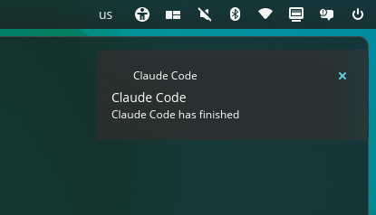

# Claude notification hook

`notify.sh` shows a desktop notification and plays a sound when Claude Code finishes a response (`Stop`) or needs your input (`Notification`).



## Setup

1. Copy the script and icon to your Claude config:

   ```bash
   mkdir -p ~/.claude/hooks
   cp notify.sh claude-icon.png ~/.claude/hooks/
   ```

2. Add this `hooks` block to `~/.claude/settings.json`, keeping your other settings:

   ```json
   "hooks": {
     "Stop": [
       { "hooks": [{ "type": "command", "command": "bash \"$HOME\"/.claude/hooks/notify.sh" }] }
     ],
     "Notification": [
       { "hooks": [{ "type": "command", "command": "bash \"$HOME\"/.claude/hooks/notify.sh" }] }
     ]
   }
   ```

3. Restart Claude Code and run `/hooks` to confirm both events are listed.

Keep `claude-icon.png` in the same folder as `notify.sh`, or the Linux notification will have no icon.

## Notification text

| Event | Notification text |
|---|---|
| `Stop` | "Claude Code has finished" |
| `Notification` | The event's message, or "Claude needs your input" if none |

## Platform support

- **Linux:** sends the notification over D-Bus with `gdbus` and plays a sound with `paplay` if installed. Without `gdbus`, it rings the terminal bell instead.
- **macOS:** uses `osascript` for the notification and `afplay` for the sound.
- **Windows (Git Bash, MSYS, Cygwin):** shows a balloon tip through PowerShell.

The script always exits `0`, so a failed notification never interrupts Claude.

## Testing manually

```bash
echo '{"hook_event_name":"Stop"}' | bash ~/.claude/hooks/notify.sh
```
